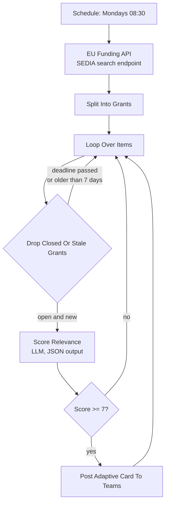

# EU Funding Radar

Polls the EU funding portal on a schedule, has an LLM score every open call against your organisation's mission, and pushes only the ones worth a researcher's time into Microsoft Teams.

## Flow

## Design notes

**The cutoff is not in the prompt.** The model returns `score` and `summary`; a plain IF node decides what 7 means. Thresholds hidden inside prompts are invisible and untunable — anyone can open the workflow and see this one, change it, and know immediately what changed. If alerts are too noisy, raise the IF to 8 before you touch the prompt.

**The freshness filter runs before the LLM, not after.** `Drop Closed Or Stale Grants` checks two things: the deadline is in the future, and `esDA_FirstIngestDate` is within the last 7 days. Filtering first means you pay for scoring only on calls that could actually be acted on. On a weekly schedule the 7-day window and the trigger interval line up, so nothing is scored twice.

**Every alert carries the model's reasoning.** The Adaptive Card shows title, programme, score and the one-line "why it matters". When scoring drifts, the person reading Teams can see it drifting and tell you — which is the only cheap evaluation signal a system like this gets.

**The prompt tells the model not to be helpful.** "Do not inflate scores to be helpful. A low score with a clear reason is more useful than a high score that wastes a researcher's afternoon." Without that line, models cluster scores at 7-8 and the threshold stops discriminating.

## Configure

| What | Where |
|---|---|
| `{{ORGANISATION_NAME}}`, `{{ORGANISATION_MISSION}}` | `Score Relevance` system prompt |
| Search keywords | `EU Funding API` node, `text` query parameter (currently `Enlargement Democracy`) |
| Relevance threshold | `Score >= 7?` node |
| `YOUR_TEAMS_WEBHOOK_URL` | `Post Adaptive Card To Teams` |

The sticky note in the workflow suggests the obvious next step: move the keywords into a one-column Airtable table so non-technical staff can change what the radar watches without opening n8n. That is how the sibling workflows handle configuration and it is the single best upgrade to make here.

## Limits

- Recall depends entirely on the keyword query. The radar cannot score a call the API never returned.
- One model call per grant, no ensembling — scores are not stable to the decimal, which is why the threshold is coarse.
- De-duplication relies on the 7-day ingest window. A call re-published with a new ingest date will surface twice.
