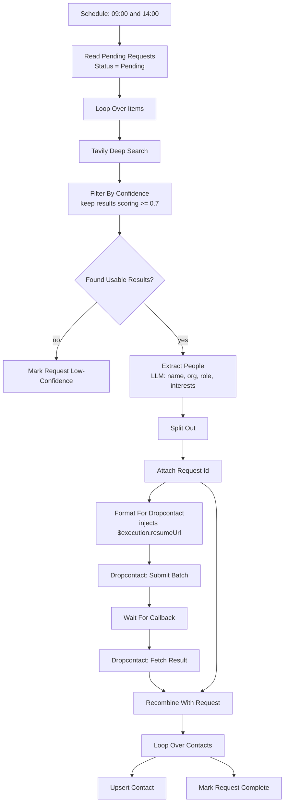

# GDPR Contact Enricher

Turns a plain-language research request typed into Airtable — "policy experts in Poland", "health policy experts in Germany" — into verified contact records, without anyone scraping an inbox.

## Flow

## Design notes

**The confidence gate comes before the LLM, and failure is a visible state.** `Filter By Confidence` keeps only Tavily results scoring 0.7 or above and sets a `found_data` boolean. If nothing clears the bar, the request is marked `Failed - Low Confidence` in Airtable rather than silently producing nothing. The person who typed the prompt can see that their prompt was too vague and rewrite it. A pipeline that returns zero contacts with no explanation gets abandoned within a week.

**Enrichment is delegated, deliberately.** The LLM extracts *names and organisations* from search results. It never guesses an email address. Dropcontact — a GDPR-compliant enrichment provider — resolves the actual contact details from its own lawful source. That split is the entire compliance story: model does entity extraction, licensed provider does personal data, and no address is ever inferred or scraped.

**Every automated record is tagged.** `Upsert Contact` writes `Role/Category = "New Contact n8n"`. Months later, anyone can filter the CRM to see exactly which records came from automation and which a human entered. Building that in from day one costs nothing; retrofitting it is impossible.

**The async callback uses `$execution.resumeUrl`.** Dropcontact enrichment is not instant, so `Format For Dropcontact` reads the URL of the *upcoming* Wait node at runtime and passes it as `custom_callback_url`. The workflow suspends, Dropcontact calls back, execution resumes. The `Wait` node also has a 90-second fallback so a callback that never arrives does not hang the run forever.

**Upsert, not create.** Matching is on name plus organisation, so re-running a request updates rather than duplicating. Requests are also marked `Completed` at the end, so the `Status = Pending` filter makes the whole workflow idempotent by construction.

## Configure

| What | Where |
|---|---|
| Confidence threshold (0.7) | `Filter By Confidence` code node |
| Role and interest taxonomies | `Extract People` system prompt, and the `Role/Category` field options |
| `TAVILY_API_KEY`, `DROPCONTACT_API_KEY` | environment variables |
| Dropcontact credential | `Dropcontact: Submit Batch`, `Dropcontact: Fetch Result` |

`Manual: Webhook Setup` is a disabled one-shot node for registering a Dropcontact webhook subscription. It is left in place because it documents the setup step; it is not part of the running flow.

## If you fork this

It processes personal data about people who never asked to be in your CRM. Two properties are worth keeping: enrichment through a compliant provider rather than scraping, and the tag on every automated record. Add a retention policy and a route for deletion requests — this workflow creates records but has no path to remove them, which is the honest gap in it.
