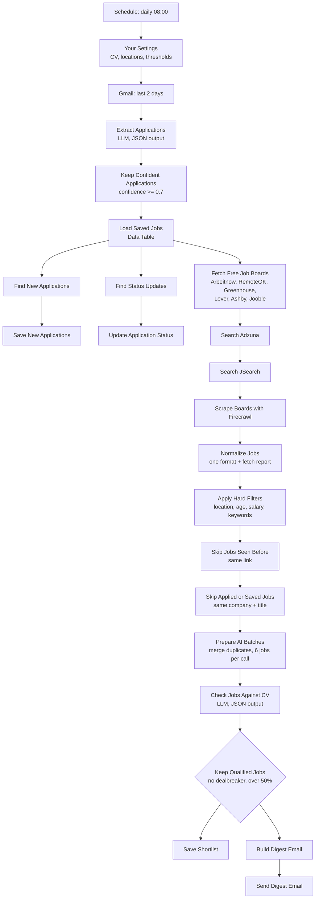

# Job Scout

Collects fresh listings from ten job sources every morning, has an LLM check each job description against your CV, and emails a short list of the jobs you actually qualify for. It also reads your Gmail and keeps a log of the applications you send, so nothing you have already applied to shows up again.

## The problem it solves

Job boards rank by keyword, not by fit. A search for "automation engineer" returns hundreds of listings a day, most of which want five years of experience, native German or a senior title, and the only way to find that out is to open each one. The same job also turns up on three boards under three different links, and boards like Jooble change their links daily, so "have I seen this?" is harder to answer than it looks. This workflow reads the descriptions so you don't have to, and remembers what you have seen and applied to.

## Flow

## Design notes

**The model reads the description, never the title.** Titles are marketing. "AI Engineer" can mean a prompt-writing junior role or a research position that wants a PhD. The prompt sends each job's description with the CV and tells the model to list the concrete requirements, check each one against the CV, and return `qualified_pct`, `met` and `missing`. The title is passed only so you can recognise the job in the digest.

**The model judges, a Code node decides.** The model returns a percentage and an optional `dealbreaker` reason; `Keep Qualified Jobs` applies the cutoff (`minQualifiedPct`, default 50) and the dealbreaker rules. The thresholds sit in `Your Settings`, where you can see and change them, not in a paragraph of prompt text.

**Dealbreakers have a deterministic backstop in both directions.** Models are inconsistent about experience requirements: sometimes they let "7+ years" through with a score of 60, sometimes they treat "2+ years" as a dealbreaker. `Keep Qualified Jobs` corrects both. A `missing` item that names a minimum at or above `dropIfYearsRequiredAtLeast` (default 5) is turned into a dealbreaker; a dealbreaker whose only reason is a smaller number of years is ignored and the score decides. Explicitly senior titles (Senior, Lead, Principal, Staff, Head of, Mid-level, Teamleitung) are caught by a title check, with "Junior/Senior" and "(Senior)" treated as open to juniors.

**Language requirements use a two-step rule.** A language the CV doesn't list, or a level two CEFR steps above the CV (C1 required, B1 on the CV), is a dealbreaker. One step (C1 required, B2 on the CV) goes under `missing` and the score decides. This keeps out the jobs you can't do without throwing away the ones where the gap is a stretch, not a wall.

**Remote means the job says so, not the description.** `Apply Hard Filters` counts a job as remote only when its own location or title says remote, anywhere or home office. "Hybrid, remote days possible" in the description of an Amsterdam job does not make it a job you can do from Berlin.

**Three layers of "seen it before", because each one misses something.** `Skip Jobs Seen Before` remembers every link across executions; it catches the same posting on the same board. `Skip Applied or Saved Jobs` compares company and exact title against every row in the Data Table, after removing gender tags like (m/w/d), legal suffixes and words like "remote" or "Vollzeit"; it catches boards that change their links every day, and jobs you applied to from somewhere else. `Prepare AI Batches` merges the same company and title arriving from several boards in one run, keeping the longest description, so you don't pay to score one job three times.

**Application tracking is deliberately conservative.** The email model returns a confidence for each application it finds. `Keep Confident Applications` keeps only records with a company, a role title and confidence of at least 0.7. A vague record would be worse than none: it could hide a job you never applied to.

**Every source can fail without stopping the run.** Each HTTP node continues on error, and `Normalize Jobs` puts a `_fetch_report` on its first item with the number of jobs per source and every source that failed or returned nothing. If Gmail or the email model fails, application tracking is skipped for that day and the job search still runs. A source that quietly returns zero is the failure you otherwise never notice.

**Malformed JSON loses one job, not a batch.** If a model answer is not a valid JSON array, `Keep Qualified Jobs` falls back to parsing each job object on its own. One missing comma costs one job.

## Configure

Everything you are expected to edit is in the `Your Settings` node.

| What | Setting |
|---|---|
| Your CV, as plain text with dates and language levels | `cvText` |
| Where you can work | `homeCountry`, `locations`, `remoteOk` |
| Match threshold | `minQualifiedPct` (default 50) |
| Experience limit | `dropIfYearsRequiredAtLeast` (default 5) |
| Drop senior / mid-level roles | `dropSeniorRoles` (default true) |
| Salary floor and maximum age | `salaryFloorEUR`, `maxAgeDays` |
| Keywords that always disqualify | `dealbreakerKeywords` |
| Company career pages | `greenhouseBoards`, `leverCompanies`, `ashbyBoards` |
| Search terms per source | `adzunaKeywords`, `jsearchQueries`, `joobleKeywords`, `arbeitsagenturKeyword` |
| Boards to scrape | `firecrawlBoardUrls` |
| Source switches | `useArbeitnow`, `useRemoteOk`, `useArbeitsagentur` |
| Digest addresses | `digestToEmail`, `digestFromEmail` |

Credentials:

| Node | Credential |
|---|---|
| `Get Recent Application Emails` | Gmail OAuth2 |
| `Claude Haiku (emails)`, `Claude Haiku (scoring)` | Anthropic |
| `Send Digest Email` | SMTP |
| `Search Adzuna` | Custom Auth: `{"qs": {"app_id": "YOUR_ADZUNA_APP_ID", "app_key": "YOUR_ADZUNA_APP_KEY"}}` |
| `Search JSearch` | Header Auth: name `X-RapidAPI-Key`, value your RapidAPI key |
| `Scrape Boards with Firecrawl` | Bearer Auth: your Firecrawl key |

Jooble needs its key inside the URL path, which n8n credentials can't do, so it goes into `joobleApiKey` in `Your Settings`. Leave `YOUR_JOOBLE_API_KEY` as it is to skip Jooble. No key for Adzuna, JSearch or Firecrawl? Deactivate that node; the rest of the run is unaffected.

Create an n8n Data Table named **Job Scout Jobs** with these columns:

| Column | Type | Notes |
|---|---|---|
| `job_id` | String | Hash of title, company and link; `applied:…` for logged applications |
| `source` | String | Which board the job came from |
| `title`, `company`, `location`, `url` | String | |
| `score` | Number | `qualified_pct` from the AI check |
| `reasons` | String | What you meet |
| `flags` | String | What's missing; for applications, the outcome (applied, rejected, interview) |
| `salary_min`, `salary_max` | String | When the board provides them |
| `posted_at`, `fetched_at`, `applied_at`, `outcome_at` | Date | |
| `status` | String | `shortlisted` or `applied` |

The workflow's error workflow is set to `YOUR_ERROR_WORKFLOW_ID`. Point it at your imported [LLM Error Logger](llm-error-logger.md), or at any workflow with an Error Trigger, so a failed morning run reaches you instead of a log nobody opens.

## Limits

- The defaults are Germany-focused: German job sources, German gender tags and German dealbreaker wording. It works elsewhere, but change `homeCountry`, `locations` and the search lists first.
- The German Federal Employment Agency source is off by default because its API currently rejects requests (403). Switch `useArbeitsagentur` on to try it.
- The AI check is only as good as the description. Boards that return a two-line snippet produce a rough score, and a listing with no description at all is dropped before scoring.
- Application tracking depends on the confirmation emails companies send. An application submitted through a portal that never emails you is not logged, and the job can come back. Add it to the Data Table by hand.
- Matching applied jobs needs the same company and the exact same title. A company that re-posts the role under a slightly different title will show it again. That is deliberate: a false match would hide a job you never applied to.
