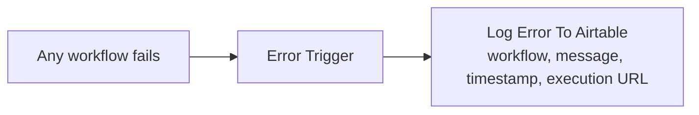

# LLM Error Logger

Two nodes. Catches any failed execution anywhere in the n8n instance and writes it to a table people can actually read.

## Flow

## Why this is the most important workflow here

An automation that fails silently is worse than no automation, because people keep trusting its output. The default n8n failure path is a log entry that a non-technical team will never open. This turns every failure into a row in the same Airtable base they already use, with a link straight back to the failed execution.

It is also the reason the other four survived handover. When the person who built the pipelines leaves, the question that matters is not "how do I fix this" — it is "is anything broken right now". A grid view of this table filtered to `Status = Open` answers that in one glance.

## Setup

Import it, then in **every** other workflow: *Settings → Error Workflow → LLM Error Logger*. Do this before enabling any schedule.

The table has a `Severity Level` field (Info / Warning / Error / Critical) that this version does not populate — severity belongs to the workflow's own configuration, not to the error payload. Set it by hand, or extend the workflow to map workflow names to severities.

## Extending it

The natural next step, and the one worth doing if your users are non-technical: insert an LLM node between the trigger and the Airtable write that rewrites the raw error into three fields — cause, impact, next step. `Firecrawl API returned 429` becomes "the monthly Firecrawl credit limit was reached; no vacancies were collected this run; the next scheduled run on Monday will retry, or upgrade the plan to run it now."

Keep the raw payload alongside the translation. Translating away the actual error trades one unusable log for another.
