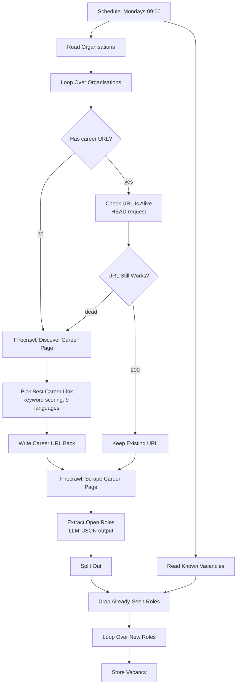

# Self-Healing Job Radar

Watches the career pages of a list of organisations, extracts open vacancies as structured records, and repairs its own source data when a career-page URL dies.

## The problem it solves

Scrapers built on a list of URLs rot. Sites get redesigned, `/careers` becomes `/join-us`, and the pipeline quietly reports "nothing new" forever while nobody notices. This one treats a dead URL as a task rather than a failure.

## Flow

## Design notes

**The write-back is what makes it self-healing.** When discovery finds a new career page, `Write Career URL Back` updates the Organisations table before scraping continues. The repair happens once. Without that node the pipeline would rediscover the same moved page on every single run, paying for the crawl every time.

**Firecrawl over a plain HTTP request, for one specific reason.** Not JavaScript rendering — the deciding factor is that Firecrawl's map endpoint can be pointed at a root domain and asked to *find* a page. A `GET` on a dead `/careers` returns 404 and the pipeline is stuck; a crawl returns whatever replaced it.

**Link selection is deterministic, not a model call.** `Pick Best Career Link` filters discovered links against a keyword list covering nine languages (`career`, `vacanc`, `karriere`, `emplois`, `stellen`, `trabajo`, `vacature`, `työpaikat`, `lediga`) and then picks the *shortest* match, on the reasoning that the shortest matching URL is usually the index page rather than one specific posting. This is cheap, debuggable, and does not hallucinate. It is also the weakest link — see limits.

**HEAD before scrape.** `Check URL Is Alive` runs a HEAD request with `neverError` set so a 404 becomes data instead of a thrown execution. Cheap check, expensive operation avoided.

**De-duplication is a merge, not a prompt instruction.** `Read Known Vacancies` pulls existing titles in parallel with the scrape, and `Drop Already-Seen Roles` uses a `keepNonMatches` merge on title and snippet. The model is *also* told to skip already-processed listings, but the merge is what actually guarantees it.

## Configure

| What | Where |
|---|---|
| Keyword list for link discovery | `Pick Best Career Link` code node |
| Schedule | `Schedule Trigger` (weekly, Mondays 09:00) |
| Table ids | `Read Organisations`, `Read Known Vacancies`, `Store Vacancy` |
| `FIRECRAWL_API_KEY` | environment variable, read by both Firecrawl nodes |

Seed the Organisations table with a name and a `Website URL`. Leave `Career Page` blank — the radar fills it in on the first run.

## Limits

- Shortest-matching-URL is a heuristic. A site whose shortest career-ish link is a single job posting will get scraped narrowly.
- Organisations that put vacancies behind a job-board subdomain, a login, or a PDF will yield nothing and are not currently flagged for human review. Adding that flag is the first improvement worth making.
- Deadline extraction is best-effort: "rolling" and "until filled" return null by design rather than an invented date.
