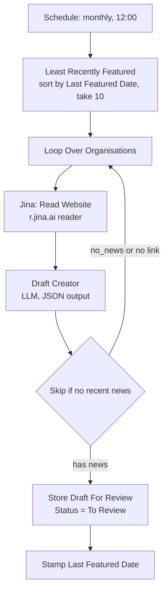

# Spotlight Content Generator

Drafts a monthly LinkedIn post about whichever tracked organisation you have featured least recently. A human approves every draft before anything is published.

## Flow

## Design notes

**Fair rotation without a scheduler.** `Least Recently Featured` sorts the Organisations table by `Last Featured Date` ascending and takes ten. `Stamp Last Featured Date` writes `$now` after a draft is stored. That pair is the whole rotation mechanism: no queue, no state file, no cron logic. Every organisation gets its turn, and the ordering self-corrects if a month is skipped.

**Skip-and-re-loop instead of publishing filler.** If the model finds no news from the last three months, it returns `status: "no_news"` and the IF node sends the loop to the next organisation. It does not publish a vague post about an organisation that has done nothing newsworthy, and it does not stamp the date — so that organisation stays at the front of the queue for next month.

**Jina AI over Firecrawl, and the reason is cost.** This workflow runs once a month. Jina's reader endpoint (`r.jina.ai/<url>`) has a free tier with enough monthly tokens to cover it, and extraction quality on a news page is comparable. Firecrawl is the right tool for the Job Radar, which runs weekly across many sites and needs crawl-and-discover. Matching the tool to the run frequency rather than defaulting to the most capable one is the whole decision.

**A human is in the loop by construction, not by policy.** Drafts land in Airtable with `Status = To Review`. Nothing posts automatically. The social media manager opens the table, reads the draft, and approves or rewrites it. The automation removes the blank page, not the judgement.

**The link is a hard requirement.** The IF node checks both `status != no_news` *and* that a link is present. A spotlight post with nothing to link to is not worth a reviewer's time.

## Configure

| What | Where |
|---|---|
| `{{ORGANISATION_NAME}}` | `Draft Creator` system prompt |
| Batch size (10 per run) | `Least Recently Featured` limit |
| News recency window (3 months) | `Draft Creator` system prompt |
| Tone and style rules | `Draft Creator` system prompt |

## Limits

- The reader sees the site's front page. An organisation that buries news two clicks deep will read as having none.
- "Recent" is judged by the model against text that may not carry dates. Front-page content is usually recent by construction, which is what makes this work at all.
- One pass, no evaluation loop. Draft quality is assessed by the human reviewer, which is appropriate here and would not be for anything publishing unattended.
